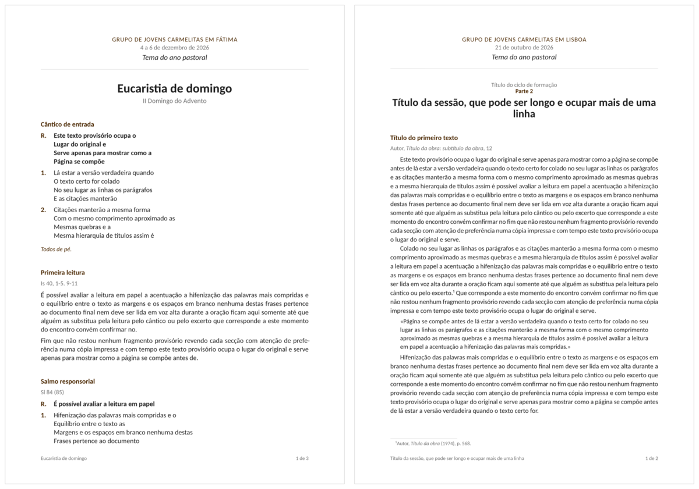

# carmelites

Typst templates for the documents of a Discalced Carmelite youth group, in Portuguese:

- **`prayer-guide`**, a guide for a prayer session, a Noite de Oração Carmelita or a Eucharist: chants, readings, texts of saints and popes, rubrics, intercessions and the *Pistas de Oração*;
- **`formation`**, a handout for a formation session: a series and its part, the session's title, then texts with their author and work, footnotes, long quotations and ruled space for notes.



Both open with the group's masthead (the group, the dates, the year's motto) and the session's title. The look follows the rules of [tech-report](../tech-report/README.md): neutral grays and a single accent, here the brown of the Discalced Carmelites as [carmelitas.pt](https://carmelitas.pt/) uses it, on signposts only (the group's name, headings, the R. of refrains, rubrics, card titles). Everything is set in Calibri, the typeface of the group's own documents, with bold headings as those documents have them. Pages print well in black and white.

Names in the source (functions, parameters, files) are English; everything printed is Portuguese.

## Install

From the repository root, `./scripts/link-local.sh` links the package as `@local/carmelites:0.1.0` (see the [repository README](../../README.md)).

### Fonts

Everything is set in **Calibri**, as in the group's Word documents. Calibri is Microsoft's and is licensed with Windows and Office, so it cannot be installed from Arch's repositories; the template asks for it first and otherwise uses **Carlito**, Google's free stand-in, whose every letter has the same width, so lines and pages break as they would in Calibri:

```bash
sudo pacman -S ttf-carlito
```

To use the real Calibri, copy its licensed font files (`calibri.ttf`, `calibrib.ttf`, `calibrii.ttf`, `calibriz.ttf`) into `~/.local/share/fonts`; documents pick it up on the next compile. Without either font the template falls back to Liberation Sans and Typst warns `unknown font family: calibri`.

## Start a gathering

```bash
typst init @local/carmelites:0.1.0 fatima-2026-12
cd fatima-2026-12
typst watch prayer-guide.typ
```

The folder holds three files:

- `gathering.typ`: the group, the dates and the motto (`gathering`), typed once for every document of the gathering;
- `prayer-guide.typ`: a prayer guide;
- `formation.typ`: a formation handout.

Copy `prayer-guide.typ` once per moment of prayer; each compiles to its own PDF.

## Documents

```typst
#import "@local/carmelites:0.1.0": *
#import "gathering.typ": gathering

#show: prayer-guide.with(..gathering, title: [Oração da noite de sábado])
```

```typst
#show: formation.with(
  ..gathering,
  series: [Uma espiritualidade: o cultivo das virtudes],
  part: 3,
  title: [Purificação],
)
```

| Parameter | In | What it does |
|---|---|---|
| `group` | both | Group name, at the top in spaced capitals. |
| `date` | both | A `datetime`, a pair of them for a weekend ("9 a 11 de outubro de 2026"), or text. |
| `motto` | both | The year's theme, in italics under the date. |
| `title` | both | The session's title; also in the footer and the PDF title. |
| `subtitle` | `prayer-guide` | A line under the title. |
| `series`, `part` | `formation` | The series of formations and the part number ("Parte 3"), above the title. |
| `paper` | both | Page size, `"a4"` by default (`"a5"` for a folded booklet). |
| `theme` | both | Partial design theme, merged over the defaults (see below). |

From the second page on, the footer shows the title and "2 de 3"; a single sheet has none. Text is Portuguese (`lang: "pt", region: "PT"`), for hyphenation and quotation marks.

## Components

Each moment or text is a heading, optionally followed by its source:

```typst
= Do Evangelho segundo São Lucas
#source[Lc 1, 46-55]
```

| Component | For |
|---|---|
| `= Heading`, `== Heading` | A moment of the guide ("Cântico inicial", "Cântico final") or a text of the formation. |
| `#source[..]` | The reference or source under a heading: a citation, or the author and work. |
| `#chant(..)` | A chant (below). |
| `#verses("..")` | Text kept line by line: a reading in verse, a psalm, a poem, a prayer said together. |
| `#rubric[..]` | An instruction not read aloud, in italics: "Todos de pé". |
| `#hints(title: [..])[..]` | *Pistas de Oração* in a fine brown frame with the title set into its top line; the title defaults to "Pistas de oração". Write the hints as a list (`-`); they are numbered I, II, III and set well apart. The frame's title names the section, so it needs no heading of its own. Each hint stays whole, and a frame that runs over a page closes on each piece. |
| `#intercessions(response: [..])[..]` | The response marked R., then the intentions as a list. |
| `#notes(lines: 6)` | Ruled lines for notes taken by hand, titled "Notas". |
| `#quote(block: true)[..]` | In a formation, a long quotation, indented. |
| `#footnote[..]` | Footnotes, as usual. |
| `#placeholder(n)`, `#placeholder-lines(..)` | Portuguese placeholder text (below). |

### Chants and verses

Typst joins lines typed one under another, so `#chant` and `#verses` take the text as a string, pasted as it is: one line per line, a blank line between stanzas. Each line is markup, so `*bold*` and `_italic_` work.

```typst
#chant(
  refrain: "
    First line of the refrain
    Second line of the refrain
  ",
  "
    First stanza, first line
    First stanza, second line

    Second stanza, first line
    Second stanza, second line
  ",
)
```

- `refrain` comes first, in bold, marked R.
- Stanzas are numbered when there is more than one; `numbered: false` or `true` overrides.
- `columns: 2` sets the parts side by side, balanced by their number of lines, with a hairline between them.
- A line too long for the column wraps with an indent, so it does not pass for a new line.
- Content instead of a string is also accepted, with lines broken by `\`.

### Placeholder text

While a reading or a chant is still to come, `placeholder` gives Portuguese placeholder words, the counterpart of `lorem`; their sentences say they are provisional, so they cannot pass for a quotation:

```typst
#placeholder(60)                         // sixty words as a sentence
#placeholder(9, from: 40, end: "!")      // further into the text, closed by !
#chant(placeholder-lines(7, 4, 5))       // three lines, for #chant or #verses
```

## Theme

The tokens have the same names as in tech-report.

| Token | Default | Used for |
|---|---|---|
| `ink` | `luma(29)` | Text |
| `secondary` | `luma(110)` | Dates, sources, footer, list markers |
| `separator` | `luma(210)` | Hairlines |
| `accent` | `#4a2700` | The accent: Carmelite brown; a lighter tint draws the hints frame |
| `fonts` | `(body:, labels:)` | Font stacks for texts and for labels (headings and card titles in bold) |
| `body-weight` | `"regular"` | Weight of the text face |

For example, a lighter brown and Vollkorn, the serif of carmelitas.pt:

```typst
#show: prayer-guide.with(..gathering, theme: (accent: rgb("#7a4a1e"), fonts: (body: "Vollkorn")))
```

## Example

`example/prayer-guide.typ` and `example/formation.typ` use every component with Portuguese placeholder text:

```bash
typst watch example/prayer-guide.typ
```
