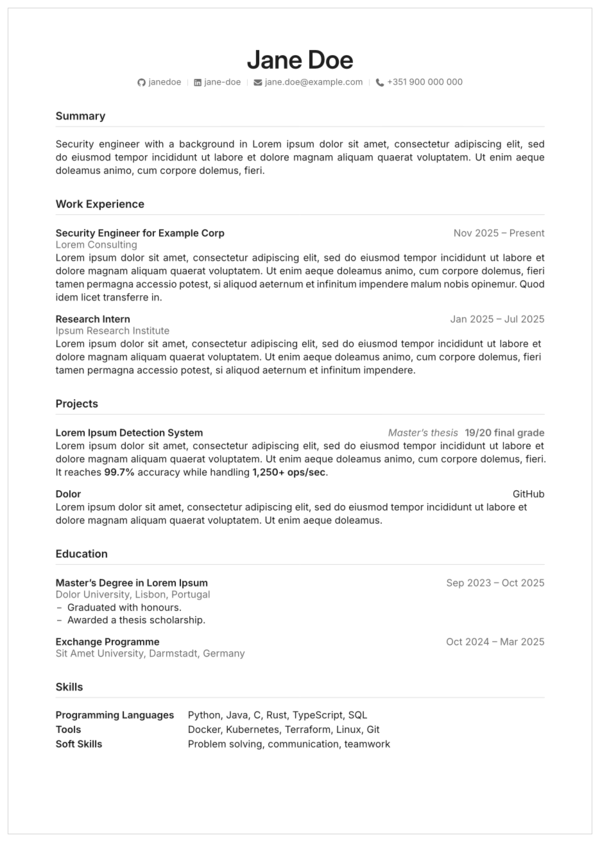

# cv

A minimal CV in the style of the other templates here, in black tones only: Inter, black and neutral grays, sections over hairlines, and entries with their dates, grade or link set right.



## Install

From the repository root, `./scripts/link-local.sh` links the package as `@local/cv:0.1.0` (see the [repository README](../../README.md)).

### Fonts

Text is set in **Inter** and the name in **Inter Display**; the contact icons come from **Font Awesome 7**, as OTF files (Typst cannot read the WOFF2 copies some systems install). On Arch:

```bash
sudo pacman -S inter-font otf-font-awesome
```

Without Font Awesome, Typst warns `unknown font family: font awesome 7 brands` and the icons are left out; set `icons: false` to drop them on purpose.

## Start a CV

```bash
typst init @local/cv:0.1.0 cv
cd cv
typst watch cv.typ
```

```typst
#import "@local/cv:0.1.0": *

#show: cv.with(
  name: "Jane Doe",
  contacts: (
    github: "janedoe",
    linkedin: "jane-doe",
    email: "jane.doe@example.com",
    phone: "+351 900 000 000",
  ),
)

= Summary
...
```

| Parameter | Default | What it does |
|---|---|---|
| `name` | `none` | The name at the top; also the PDF title and author. |
| `contacts` | `(:)` | The contact line, in the order given (below). |
| `icons` | `true` | Font Awesome icons before each contact. |
| `paper`, `lang` | `"a4"`, `"en"` | Page size and text language (hyphenation, quotes). |
| `theme` | `(:)` | Partial theme, merged over the defaults (below). |

### Contacts

Known kinds get an icon and a link built from the value:

| Key | Value | Link |
|---|---|---|
| `github` | user name | `https://github.com/<value>` |
| `linkedin` | profile id | `https://www.linkedin.com/in/<value>` |
| `email` | address | `mailto:` |
| `phone` | number, spaces allowed | `tel:` without spaces |
| `website` | address | `https://` added when missing |
| `location` | place | none |

Any other key is shown as given. To show other text than the value, give `(value: "..", label: [..])`.

## Sections and entries

Each section is a level-one heading. Inside it:

```typst
= Work Experience

#entry(
  title: [Research Intern],          // bold, left
  subtitle: [INESC-ID],              // gray, under the title (optional)
  meta: [Jan 2025 -- Jul 2025],      // gray, right: dates, a grade or a link
)[
  What you did, as a paragraph or a list.
]

#entry(title: [Solidview], meta: link("https://github.com/..")[GitHub])[..]

= Skills

#skills((
  "Programming Languages": [Python, Rust, Solidity],
  "Tools": [Docker, Kubernetes],
))

= Languages

#languages((
  Portuguese: [Native],
  English: [C2 Proficiency],
))
```

- `entry` keeps its title, meta and body on one page; give `[]` as the body for an entry with no description.
- `skills` sets labels and values in two columns, ragged and unhyphenated, so tool names stay whole.
- `languages` joins each language to its level with dot leaders.
- Lists inside entries are marked by a short drawn rule; links in the text take the accent (black by default), links in the contact line stay gray.

## Theme

| Token | Default | Used for |
|---|---|---|
| `ink` | `luma(29)` | Text |
| `secondary` | `luma(110)` | Contact line, subtitles, dates |
| `separator` | `luma(210)` | Hairlines, dot leaders, contact bars |
| `accent` | `luma(29)` | Section titles and links; black like the text, so the CV has no colour |
| `fonts` | `(body:, display:)` | Font stacks; `display` is for the name |

For a colour after all, set the accent: `theme: (accent: rgb("#ea580c"))` gives the Pumpkin of tech-report.

## Example

`example/cv.typ` uses every component with made-up data:

```bash
typst watch example/cv.typ
```
