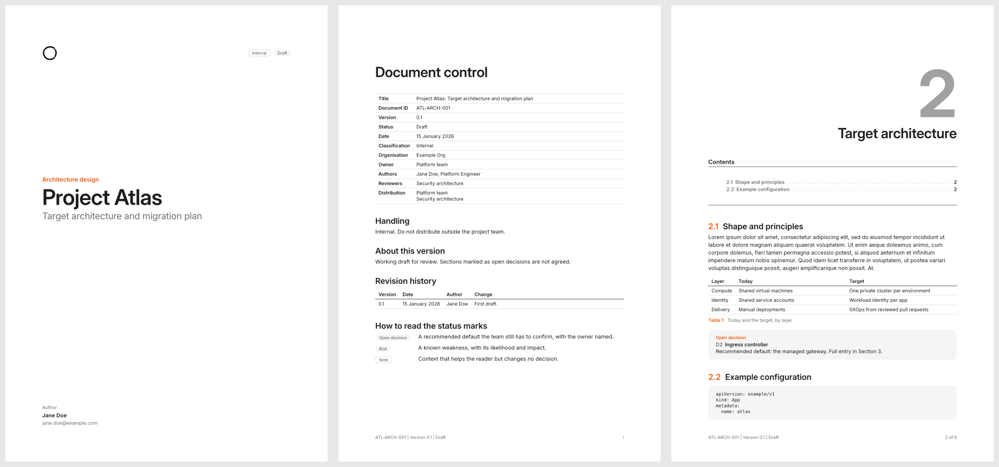

# tech-report

A Typst template for technical reports and design documents: architecture designs, security reviews, platform proposals, migration plans.



It gives a document:

- a **cover** with the logo, title, classification and draft capsules, and the authors with their e-mail addresses;
- a **document control** page: a table of the document's facts, handling, notes on the version, revision history and a key to the status marks;
- **contents**, plus **generated registers** (for example every open decision, with its page), a list of tables and a **glossary** of abbreviations, each spelled out at its first use;
- **status marks**, callouts the document defines for itself (open decision, risk, unverified, ...), which can be referenced by id;
- **chapter openers**: each numbered chapter starts a page with a large number, its title and its own contents;
- running headers with the current chapter and a **Draft** capsule until the status is final, `n of N` footers, and an **Appendix** section of lettered appendices.

The design is minimal, after Apple's documents: neutral grays, black and white, plus one orange accent kept to signposts (the label above the cover title, chapter and section numbers, callout and table labels, web links). Hairline rules instead of borders and fills, rounded gray cards for callouts, semibold headings with tight tracking, and generous white space.

## Install

The template is a local Typst package. From the repository root:

```bash
./scripts/link-local.sh
```

This symlinks `templates/tech-report` to `~/.local/share/typst/packages/local/tech-report/0.1.0`, so every document on the machine can import it and picks up edits to the template on its next compile.

### Fonts

Text is set in **Inter**, an open-source typeface (SIL Open Font License) whose proportions follow Apple's San Francisco closely; the cover title and chapter titles use **Inter Display**, its cut for large sizes, as Apple switches to SF Pro Display from 20 pt. On Arch:

```bash
sudo pacman -S inter-font
```

Without it the template falls back to Liberation Sans and Typst prints an `unknown font family` warning. Code uses DejaVu Sans Mono, the typeface Apple's Menlo is derived from, which ships with Typst.

Apple's own fonts (SF Pro, SF Mono, New York) are not the default because their licence allows them only in mock-ups of user interfaces for Apple platforms. If your use is covered by that licence, set them through the theme: `theme: (fonts: (body: "SF Pro Text", heading: "SF Pro Text", display: "SF Pro Display", mono: "SF Mono"))`.

Typst packages cannot bundle fonts, so a document that must look identical everywhere needs its fonts installed or passed with `--font-path`.

## Start a document

```bash
typst init @local/tech-report:0.1.0 my-document
cd my-document
typst watch main.typ
```

The starter `main.typ` is a short, realistic outline. To see every component at once (logo, both mark styles, registers, footnotes, quotes, term lists, figures, a table crossing pages), build the placeholder sample in this folder:

```bash
typst watch example/main.typ
```

The minimum document is:

```typst
#import "@local/tech-report:0.1.0": *

#show: report.with(
  title: "Project Atlas",
  subtitle: "Target architecture",
  version: "0.1",
  status: "Draft",
  date: datetime.today(),
)

= Introduction
...
```

## `report` parameters

Every parameter is optional. Text parameters accept strings or content; people (`authors`, `owner`, `reviewers`, `approvers`, `distribution`) accept strings or `(name: .., role: .., email: ..)` dictionaries, alone or in an array.

| Parameter | Default | What it does |
|---|---|---|
| `title`, `subtitle` | `none` | Cover title and subtitle; together they form the PDF title. |
| `short-title` | `title` | Shown in the running header. |
| `doc-type` | `none` | Small label above the title, e.g. "Architecture design". |
| `doc-id`, `version`, `status` | `none` | Document control; the footer shows them as `ID | Version n | Status`. |
| `date` | `none` | A `datetime` (printed as "8 October 2026") or text. |
| `classification` | `none` | Capsule on the cover and a row in document control. |
| `organisation` | `none` | Cover header when there is no logo, and a row in document control. |
| `logo` | `none` | `path("logo.svg")` or ready content such as `image(..)`; `placeholder-logo` is a neutral stand-in. A plain string fails, because it would resolve inside the package. |
| `keywords` | `()` | PDF keywords. |
| `authors`, `owner`, `reviewers`, `approvers`, `distribution` | `()` / `none` | Document control rows. Authors also go on the cover, with their e-mail addresses, and into the PDF metadata. |
| `handling` | `none` | Handling statement in document control. |
| `notice` | `none` | "About this version" paragraph in document control. |
| `history` | `()` | Revision history rows: `(version:, date:, author:, change:)`. |
| `marks` | `(:)` | The mark specs (see below); used for the key and the registers. |
| `registers` | `true` | Generate a register for each mark that declares one. |
| `list-of-tables`, `list-of-figures` | `true`, `false` | Lists after the registers, built from captioned figures. |
| `glossary` | `(:)` | Abbreviations and their full names: the first use is spelled out and repeated ones are listed (see below). |
| `links-accessed` | `none` | A `datetime` or text, added to every link footnote as "last accessed on ..." (see below). |
| `outline-depth` | `2` | Heading depth in the contents. |
| `heading-start` | `1` | Number of the first chapter; `0` gives "0 Executive summary". |
| `draft` | `auto` | Draft capsule on the cover and in the running header; `auto` shows it unless the status contains final, approved, issued or released. |
| `theme` | `(:)` | Partial theme of grays and fonts, merged over the defaults (see below). |
| `paper`, `lang`, `region` | `"a4"`, `"en"`, `none` | Page size and text language. |

## Status marks

Marks are callouts a document defines for itself. Declare their specs once and turn them into functions:

```typst
#let mark-specs = (
  decision: (
    label: "Open decision",        // shown above the entry
    style: "fill",                 // "fill": a gray card (default); "outline": a hairline frame
    register: "Open decisions",    // optional: generate a register with this title
    description: [A recommended default the team still has to confirm.],  // optional: key entry
  ),
  note: (label: "Note", style: "outline"),
)
#let (decision, note) = marks(mark-specs)

#show: report.with(marks: mark-specs, ..)
```

Use them in the text:

```typst
#decision(id: "D4", title: [Ingress controller])[
  Options: ... Recommended default: ...
]

#decision(id: "D4", title: [Ingress controller], mention: true)[
  Shortened copy elsewhere; its id links to the full entry.
]

#note[The shared database is a single point of failure.]
```

Use the two styles to separate weight rather than kind: cards for what needs attention, frames for supporting material. The label tells marks apart.

A mark with a `register` and an `id` is a **canonical entry**: it is labelled with its id, so `@D4` links to it, and it appears in the register. Add `mention: true` to repeat an entry elsewhere without listing it twice. Marks without an id are plain callouts.

## Glossary

Pass the abbreviations a document uses, each with its full name and nothing more:

```typst
#show: report.with(
  glossary: (
    API: "application programming interface",
    TLS: "Transport Layer Security",
    "CI/CD": "continuous integration and continuous delivery",  // keys that are not identifiers take quotes
  ),
  ..
)
```

The template then works as research papers do:

- The first use in the body of every abbreviation the text uses at least twice reads "full name (ABBR)", with "a" or "an" in front adjusted to the full name; later uses stay short.
- Every use of such an abbreviation, the one inside the first "full name (ABBR)" included, is set in the reference gray and links to its entry in the Glossary.
- Those entries are listed, sorted and capitalised, in a **Glossary** after the lists of tables and figures. Abbreviations used only once are neither listed nor expanded.
- A use written "(ABBR)", as in "robotic process automation (RPA)", is your own definition and is left as written.
- Headings, captions, callout titles, code and hyphenated compounds ("AKS-required") are never expanded.
- Names that merely contain an abbreviation can opt out: `#no-glossary[Argo CD]`.

Full names go in the case they take mid-sentence ("role-based access control", "Transport Layer Security"). For a long list, keep it in its own file (`#import "glossary.typ": glossary`).

The glossary is the one costly feature: its rule runs over every run of text, and which entries are used twice is only known once the whole document is laid out. On a long document it roughly doubles compile time and peak memory. `glossary: (:)` turns it off.

## References

Label headings and refer to them as usual:

```typst
== Azure layout <sec-4.2>
See @sec-4.2.
```

By default a reference reads "Section 4.2". For bare numbers ("see 4.2"), add after the show rule:

```typst
#set heading(supplement: none)
```

To write a reference as "sec 4.2", as in LaTeX documents, give it that supplement: `@sec-4.2[sec]`. The whole of "sec 4.2" becomes the link, with a non-breaking space inside it.

References to tables and figures, such as `@tab-costs` for a figure labelled `<tab-costs>`, read "Table 3" and are set in the reference gray, like glossary terms.

## Links

Web links are set as footnotes, as in research papers: the linked words stay in the text with a gray superscript number, and the URL is written at the foot of the page, followed by "last accessed on ..." when `links-accessed` is given. A bare URL leaves only the number. References, `mailto:` addresses and links to labels are left as they are.

```typst
See the #link("https://example.com/spec")[specification].     // the word, then a footnote with the URL
Published at https://example.com/post.                         // a footnote with the URL alone
Several sources: #links("https://a.example", "https://b.example").
```

`links(..)` sets several footnote numbers separated by a superscript comma, so that 1 and 2 never read as 12. Where the URLs should stand in the text instead, as in a list of sources, wrap the block in `#inline-links[..]`: bare URLs are written out in the accent, and linked words take the accent.

## Appendices

```typst
#show: appendix

= Definitions   // numbered A, its sections A.1, A.2, ...
```

`appendix` opens an **Appendix** section: a divider page, listed in the contents, that lists the appendices after it. Rename it with `#show: appendix.with(title: [Appendices])`.

## Theme

The grays are the levels of Apple's text and separator colours, without their faint blue cast; `accent` is the only colour. Override any token through `theme`; `fonts` merges key by key.

| Token | Default | Used for |
|---|---|---|
| `ink` | `luma(29)` | Body text, headings, table header rule |
| `secondary` | `luma(110)` | Labels, captions, quotes, header and footer |
| `separator` | `luma(210)` | Hairlines, outlined marks, capsules |
| `fill` | `luma(245)` | Mark cards, code, inline code |
| `reference` | `luma(110)` | Glossary terms and references to tables and figures |
| `accent` | `#ea580c` | Pumpkin orange, for the cover label, heading numbers, mark and caption labels and web links. At 3.6:1 on white it passes WCAG AA for large text; for AA in small labels and links too, use a deeper orange such as Apple's high-contrast `#c93400`. |
| `fonts` | `(body:, heading:, display:, mono:)` | Font stacks; `display` is for the cover title and chapter titles |

For example, a deeper orange and pure black text:

```typst
theme: (accent: rgb("#a63a0e"), ink: black),
```

## Long documents

Split chapters into files and keep shared definitions in one place:

```
my-document/
  setup.typ      // #import "@local/tech-report:0.1.0": *, mark specs, theme
  main.typ       // #import "setup.typ": *, #show: report.with(..), #include chapters
  chapters/
    01-introduction.typ   // #import "../setup.typ": *, then content
```

Included files have their own scope, which is why each chapter imports `setup.typ`; the show rules in `main.typ` still style them.
